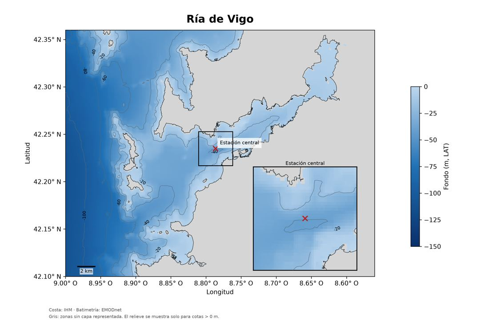

# Iberia Maps

Crea mapas científicos de costa, batimetría y relieve a partir de **un archivo de coordenadas y un comando**. Primera versión para uso local con Python: no necesita navegador ni servicios de pago.

Incluye estaciones de muestreo, acercamiento centrado en una estación, escala, isóbatas y exportación a PNG/PDF. Cada mapa lleva un JSON con las coordenadas exactas, las fuentes y la referencia vertical de la batimetría. **Los puntos nunca se desplazan para hacerlos encajar con la costa.**



## Empezar en este ordenador

Dentro de la carpeta del repositorio:

```bash
python3 -m venv .venv
.venv/bin/python -m pip install -e .
./crear_mapa.sh ejemplos/vigo.toml
```

Si tu Python del sistema no permite crear entornos virtuales, utiliza un Python 3.12 o posterior que tenga `venv`. En el ordenador usado para desarrollar este proyecto está disponible `/home/erick/miniforge3/envs/huitzilin/bin/python`.

Una vez instalado, también puedes ejecutar:

```bash
.venv/bin/iberia-maps ejemplos/galicia.toml
.venv/bin/iberia-maps ejemplos/canarias.toml
.venv/bin/iberia-maps ejemplos/vigo.toml --comprobar
```

Los resultados aparecen en `salidas/`: imagen de 300 ppp, PDF y registro JSON. Repetir un comando reemplaza los resultados con el mismo nombre; cambia `salida.nombre` para conservar variantes.

## Preparar tus datos

Los archivos grandes **no se guardan en GitHub**. Para los ejemplos, coloca el paquete de datos ya descargado junto al repositorio:

```text
carpeta_de_trabajo/
├── iberia-maps/
│   ├── ejemplos/
│   └── crear_mapa.sh
└── iberia-maps-data/
    ├── batimetria/
    ├── costa/
    └── relieve/
```

Los ejemplos leen los archivos de ese paquete. Si están en otro lugar, cambia `datos.carpeta`. El modo `"auto"` elige la batimetría de mayor detalle que cubra todo el marco y el relieve que mejor lo intersecte. También puedes indicar rutas explícitas por capa. **Todas las rutas del TOML se resuelven desde el propio archivo TOML.**

Consulta [DATOS.md](DATOS.md) para conocer formatos, cobertura y fuentes. El programa usa datos locales; esta versión no promete descargar automáticamente la cartografía de cualquier región.

## Crear otro mapa

1. Copia `ejemplos/vigo.toml` con otro nombre en la misma carpeta.
2. Cambia `oeste`, `este`, `sur`, `norte` en `[mapa]`.
3. Deja las capas en `"auto"`: el programa elige los archivos locales adecuados. Si no hay cobertura, te lo indicará.
4. Cambia las estaciones y el nombre de salida.
5. Ejecuta `./crear_mapa.sh ejemplos/mi_mapa.toml`.

Se aceptan grados decimales o texto con grados, minutos y segundos. Oeste y sur llevan signo negativo en formato decimal; también se admite `W` u `O` para oeste.

```toml
[[estaciones]]
nombre = "Estación central"
lat = "42° 14.09′ N"
lon = "8° 47.18′ W"
```

El mismo punto en decimal:

```toml
[[estaciones]]
nombre = "Estación central"
lat = 42.23483333333333
lon = -8.786333333333333
```

Para grados, minutos y segundos puedes escribir `lat = "42° 12′ 7.081″ N"`. Véase [el ejemplo de Toralla](ejemplos/toralla.toml).

### Varios puntos desde CSV

Añade al TOML:

```toml
[puntos]
csv = "estaciones.csv"
```

Formato del CSV (UTF-8):

```csv
nombre,lat,lon
Estación central,42.23483333333333,-8.786333333333333
Otra estación,42.25,-8.80
```

La segunda estación del ejemplo es ilustrativa. Los puntos del CSV se añaden a los declarados en el TOML. Los nombres deben ser únicos y los puntos deben estar dentro del mapa. Si usas coma decimal, entrecomilla los campos o utiliza punto decimal.

### Acercamiento y relieve

```toml
[acercamiento]
activar = true
estacion = "Estación central"
ancho_km = 4.0
```

Para eliminar el acercamiento, cambia `activar = false`. En `[datos]`, usa `relieve = false` para dejar las zonas sin batimetría en gris, `relieve = "auto"` para elegir el terreno disponible, o indica la ruta de un GeoTIFF. El gris también puede indicar datos ausentes: no es una clasificación de tierra.

## Límites de esta versión

- Costa vectorial en **GeoJSON WGS84**, en orden longitud/latitud. No lee directamente Shapefile o GeoPackage: pueden exportarse a GeoJSON con QGIS.
- Batimetría en NetCDF con `longitude`, `latitude` y `elevation(latitude, longitude)`, coordenadas ascendentes y metros. La referencia vertical se lee del archivo; no se convierte LAT a MSL.
- El relieve GeoTIFF se reproyecta al dibujarlo. Se omiten cotas `<= 0 m` y valores ausentes: esta vista no representa depresiones terrestres bajo el nivel del mar. Mar y terreno conservan sus referencias verticales separadas.
- Si una malla supera dos millones de celdas, se submuestrea solo para dibujar. El factor queda registrado en el JSON. La cantidad de detalle disponible depende del archivo elegido.
- La escala horizontal es aproximada a la latitud local. Este programa está pensado para mapas regionales de España, no cartografía náutica ni mediciones geodésicas.
- No incluye todavía ríos/lagos, descarga automática de capas ni interfaz gráfica.

## Comprobación y desarrollo

```bash
.venv/bin/python -m pip install -e '.[test]'
.venv/bin/python -m pytest -q
```

Las pruebas cubren DMS, signos/hemisferios, puntos fuera del marco, CSV, cobertura, reproyección y una exportación completa con datos sintéticos. Los ejemplos reales de Vigo y Galicia se usan para la comprobación visual.

## Fuentes

Costa: Instituto Hidrográfico de la Marina. Batimetría: EMODnet. Relieve: IGN/CNIG. Conservar atribuciones y licencias de los datos al publicar los mapas; véase [DATOS.md](DATOS.md).

La posición de la estación central del ejemplo procede de Cermeño et al. ([2006](https://em.webs.uvigo.es/cermeno_estuarine_2006.pdf), sección 2.1; [2014](https://em.webs.uvigo.es/cermeno_et_al_jpr_2014.pdf), página 2): 42°14.09′ N, 8°47.18′ W.
